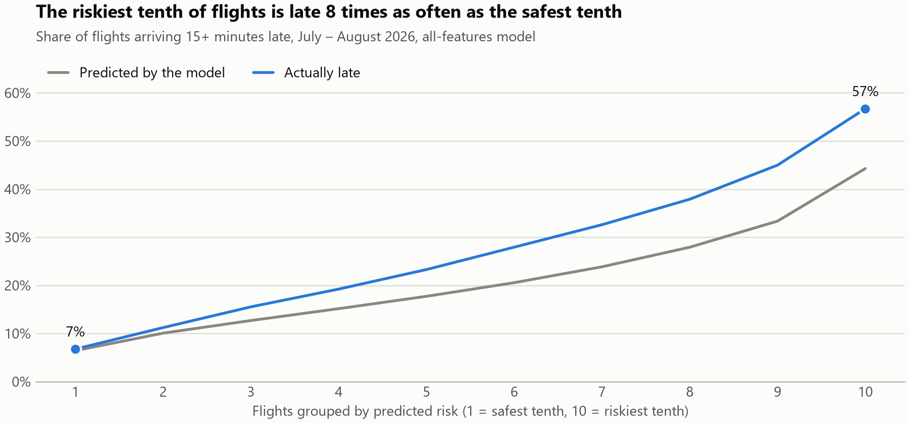
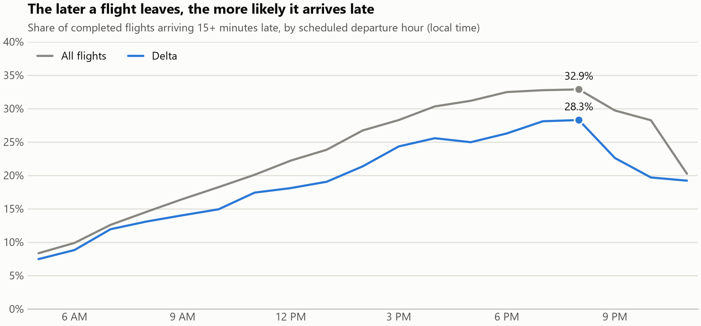
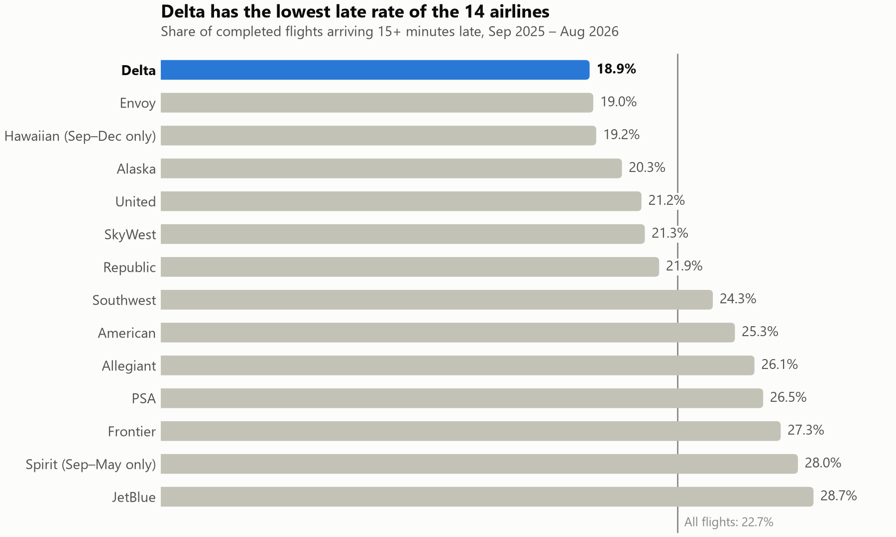
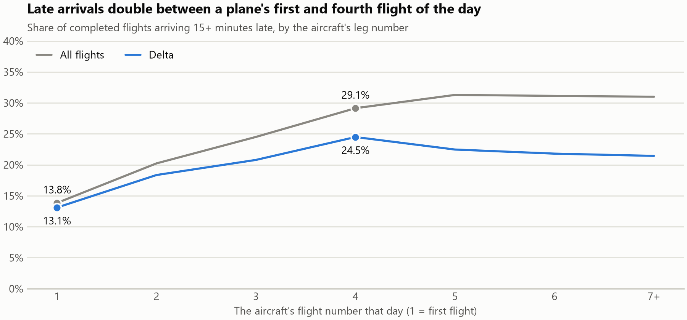
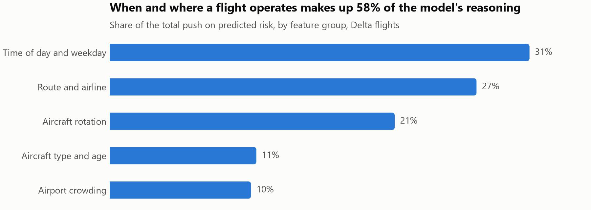
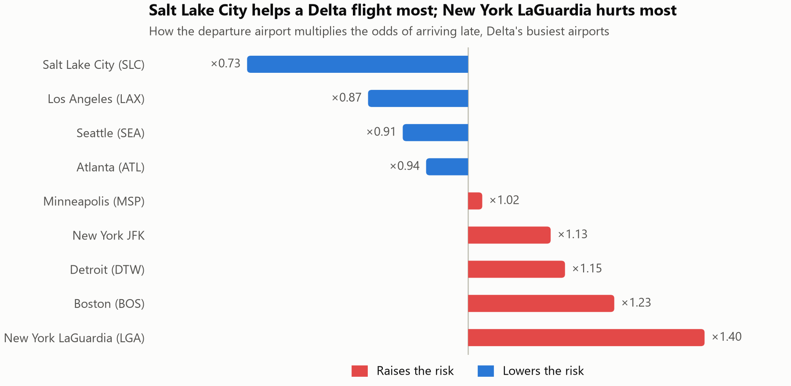
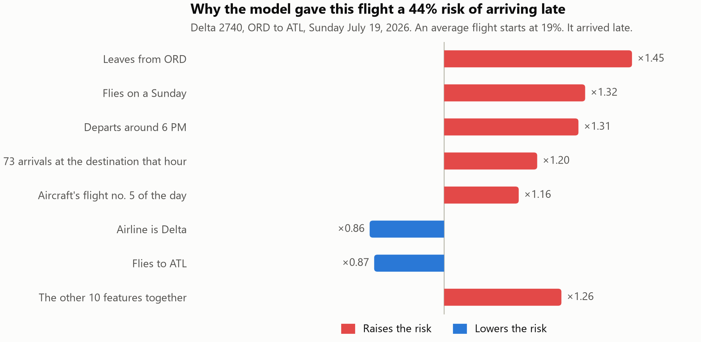

# Predicting U.S. Flight Delays

Can we tell, before a flight leaves, whether it will arrive 15 or more minutes late, and explain why?

This project trains a LightGBM model on **7 million U.S. domestic flights** (September 2025 – August 2026) from the Bureau of Transportation Statistics. It uses only information known before departure: the timetable, the airline, the route, and the aircraft's planned day. SHAP then explains what drives each prediction, with a focus on **Delta Air Lines**.

## Results at a glance

Tested on two months the model never saw (July – August 2026, 1.2 million flights, 27.6% late):

| Model | ROC-AUC | PR-AUC | Late rate in the riskiest 10% of flights |
|---|---|---|---|
| Always "on time" (floor) | 0.500 | 0.276 | 27.6% |
| Logistic regression | 0.689 | 0.431 | 50.3% |
| LightGBM, timetable only | **0.704** | 0.461 | 54.8% |
| LightGBM, timetable + aircraft features | **0.713** | 0.476 | 56.7% |

- **ROC-AUC** measures how well the model ranks late flights above on-time ones. 0.5 is guessing and 1.0 is perfect.
- **PR-AUC** is the same idea, focused on the late flights. Guessing would score 0.276.
- **0.704 is the conservative result.** The 0.713 model also uses the aircraft that flew each flight, which is not always the one that was planned (see [Two traps](#two-traps-i-had-to-handle)).
- Accuracy is not reported, because a model that always says "on time" is right 72% of the time and catches no late flights.

The ranking is useful in practice. Of the tenth of flights the model rates riskiest, 57% arrived late. Of the safest tenth, 7% did.



## What the data shows

**Delays build up through the day.** 8% of 5 AM departures arrive late, rising to 33% at 8 PM. Delta stays below the average at every hour.



**Delta has the lowest late rate of the 14 airlines** (18.9%, against 22.7% for all flights).



**A plane that falls behind stays behind.** 14% of flights are late when it is the aircraft's first flight of the day, and 29% when it is the fourth. This is the idea behind the aircraft-rotation features.



Two more findings:

- Late-arriving aircraft cause the most delay minutes across all airlines (39.9%). For Delta the largest cause is its own operations (44.1%), with late aircraft at 29.4%.
- Aircraft age makes almost no difference. Late rates stay between 21% and 24% from new aircraft to those over 25 years old.

## How it works

| Step | Code | What it does |
|---|---|---|
| 1. Download | [`src/download_bts.py`](src/download_bts.py) | Downloads 12 monthly files from BTS and rejects cut-off downloads |
| 2. Clean | [`src/load.py`](src/load.py) | Keeps 20 of 57 columns, fixes types, saves one Parquet file |
| 3. Aircraft | [`src/aircraft.py`](src/aircraft.py) | Matches each tail number to the FAA aircraft registry (99.7% matched) |
| 4. Features | [`src/features.py`](src/features.py) | Builds 20 features from the schedule |
| 5. Train | [`src/train.py`](src/train.py) | Splits by date, trains the baselines and LightGBM, saves the scores |
| 6. Explain | [`src/explain.py`](src/explain.py) | Computes SHAP values for 50,000 Delta flights |

The notebooks walk through each step in plain language: [01 Explore](notebooks/01_explore.ipynb), [02 Features](notebooks/02_features.ipynb), [03 Model](notebooks/03_model.ipynb), [04 SHAP](notebooks/04_shap.ipynb).

**The features**

| Group | Features |
|---|---|
| Time | departure hour, arrival hour, weekday |
| Route and airline | airline, origin, destination, distance, scheduled flight time |
| Airport crowding | flights scheduled at the origin and at the destination in the same hour |
| Aircraft rotation | the aircraft's leg number that day, legs planned that day, turnaround time, where it comes from, time in service |
| Aircraft | model family and age, from the FAA registry |

**The split is by date, never random.** The model trains on September 2025 – May 2026, is tuned on June 2026, and is tested once on July – August 2026. That is how it would be used in real life: predicting flights that have not happened yet.

Only `src/load.py` knows the BTS column names. It renames them to general names such as `carrier` and `tail_number`, so the rest of the code would work on another airline's data with a new version of that one file.

## What drives the predictions

SHAP measures how much each feature pushes a flight's risk up or down. For Delta flights, when and where a flight operates makes up 58% of the model's reasoning.



- **Time of day:** a Delta flight leaving at 8 PM has 2.6 times the late-arrival odds of one leaving at 6 AM.
- **Turnaround:** under 45 minutes on the ground raises the odds by 46%. The lowest risk comes with 90 minutes to 3 hours.
- **Departure airport:** among Delta's busiest airports, Salt Lake City lowers the odds the most and New York LaGuardia raises them the most.



SHAP can also explain one flight at a time. The model gave this Sunday evening flight from Chicago O'Hare a 44% risk, more than twice the average, and it did arrive late.



SHAP explains what the model learned. These are patterns, not proven causes.

## Two traps I had to handle

**1. Aircraft swaps leak the answer.** BTS records the aircraft that *actually flew* each flight. When a plane runs late, the airline often swaps in another one. The swapped-in aircraft then shows an impossible schedule: its previous flight was due to land at a different airport, or after this flight's departure. That pattern covers 5% of flights, and 57% of them arrive late. A model that sees it is reading the result of the delay, not predicting it.

- The fix: for those flights, the rotation features are replaced with the usual values for the same flight on other days.
- The check: on the test months, the model gave swapped flights an average risk of 24%, close to ordinary flights (21%), although 63% of them were late. It could not spot them.
- The remaining limit: a swap onto a plane that happens to fit the schedule cannot be detected. That is why the timetable-only score (0.704) is reported next to the full score (0.713).

**2. One year of data lets a model memorize dates.** With the day of the month and the distance to a holiday as features, the model could pin down exact dates and memorize single bad days, such as one storm on one Sunday. It stopped improving on the validation month after 13 trees. Without those features, and without the month, it grew about 1,000 trees and scored higher. This choice was made on the validation month only, never on the test months.

## Limits

- **No weather and no air traffic control data.** They cause a large share of delays and are not in a timetable. This is the main reason the score tops out near 0.7. Adding weather forecasts is the most promising next step.
- **The model underestimates summer.** It learned from calmer months, so it predicted 44% late for the riskiest tenth of flights when 57% were. The ranking holds; the percentages would need recalibrating on recent data before real use.
- **Delta is harder to predict** (ROC-AUC 0.684). Inside one airline the airline feature cannot help, and Delta's delays come mostly from its own operations, which a timetable does not show.
- **One year of data.** Each calendar month appears once, so the model cannot learn seasons.
- **October 2025** fell during a U.S. federal government shutdown, which added air traffic control delays. It sits in the training months.

## About "Delta" in this data

BTS lists each flight under the airline that operated it. "Delta" here means Delta's own (mainline) flights. Delta Connection flights operated by SkyWest and Republic are listed under those airlines, mixed with their flights for other partners. Endeavor Air does not appear in the BTS data for this period.

## Reproduce it

Windows, Python 3.11:

```
py -3.11 -m venv .venv
.venv\Scripts\python -m pip install -r requirements.txt

.venv\Scripts\python src\download_bts.py 2025-09 2025-10 2025-11 2025-12 2026-01 2026-02 2026-03 2026-04 2026-05 2026-06 2026-07 2026-08
.venv\Scripts\python src\load.py
.venv\Scripts\python src\aircraft.py
.venv\Scripts\python src\features.py
.venv\Scripts\python src\train.py
.venv\Scripts\python src\explain.py
```

The download takes about an hour (2.2 GB). Everything after it takes about 12 minutes on a 16 GB laptop. Then open the notebooks in order.

## Project structure

```
data/raw/           BTS and FAA downloads (not tracked)
data/processed/     cleaned Parquet files (not tracked)
notebooks/          01_explore, 02_features, 03_model, 04_shap
src/                the pipeline code
models/             saved LightGBM models (not tracked)
reports/            scores (metrics.csv) and feature importance
reports/figures/    charts
```

## Data sources

- [BTS Reporting Carrier On-Time Performance](https://www.transtats.bts.gov/), U.S. Bureau of Transportation Statistics
- [FAA Releasable Aircraft Database](https://www.faa.gov/licenses_certificates/aircraft_certification/aircraft_registry/releasable_aircraft_download), U.S. Federal Aviation Administration. Only the registration, model and build year are used; owner details are never read.

## Tools

Python 3.11, pandas, scikit-learn, LightGBM, SHAP, matplotlib.
